# dsh-aisketch

给 [DSH](https://github.com/deepseek-ai/deepseek-harness)（DeepSeek Harness）加一条「**模型只给结构，客户端负责作图**」的卡片通道。

**English TL;DR** — dsh-aisketch adds two extension points to DSH: `show_card` (native table / SVG flowchart / hand-drawn draw / semantic teaching figures) and `sketch_function` (six interactive plot modes). The model supplies structure only; a deterministic engine owns geometry. MIT, zero base changes.

| 工具 | 模型给什么 | 用户看到什么 |
|---|---|---|
| `show_card` | `kind` + 结构化 `payload` | 会话里的原生卡片：表格、SVG 流程图、手绘插画、教学示意图 |
| `sketch_function` | 一条函数表达式 + 参数范围（实测 4–45 token） | 可交互函数图像：六种模式、参数滑块、追踪读数 |


**零 base 改动**：全部走官方扩展点（tool 注册、`tool.call.toolview`、`conversation.chat.node`、`conversation.chat.turnTail`），没有一行改动 `@deepseek-ai/dsh-*`。

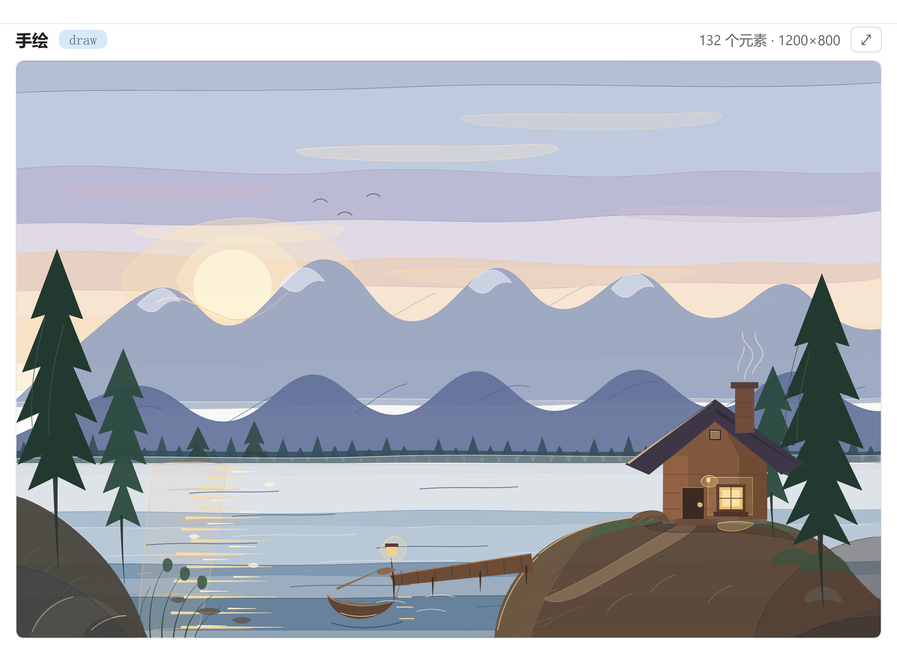

---

## 一、它补的是哪一块

模型想把一件事讲清楚时，手上常常只有文字。于是它写 Markdown 表格、画 ASCII 图，或者更糟——生成一段 HTML/SVG 让你渲染。前两者难看且难读，后者是在执行模型生成的代码，还不可回放。

`dsh-aisketch` 换了一条路：**模型只交结构，几何由确定性引擎算**。

```jsonc
// show_card：模型只给节点和连线，位置/换行/箭头锚点由客户端算
{
  "kind": "flowchart",
  "payload": {
    "nodes": [
      { "id": "check", "label": "n 是偶数？", "shape": "decision" },
      { "id": "even",  "label": "输出 n/2",   "shape": "process"  }
    ],
    "edges": [{ "from": "check", "to": "even", "label": "是" }]
  }
}
```

同一份 payload 必然画出同一张图；回放一个旧会话，卡片一模一样，不需要 Host 再参与。

### 与 DSH 本体的关系

| | DSH 本体已有 | 本插件补的 |
|---|---|---|
| 卡片怎么来 | 每个内置工具自己的卡片模型（read / grep / diff / terminal / web / image …），渲染器写死在客户端 | **一条通用通道**：模型自选内容，`kind` 决定用哪个渲染器；加一种卡片 = 注册一个组件 |
| 交付物 | `present`：把**已有文件**声明为最终交付物，只记路径不搬内容 | 把**结构化内容本身**交付到会话里，不需要先落盘 |
| 图表/流程图 | 官方工具目录里没有通用绘图、图表、流程图工具 | 表格、流程图、手绘、教学示意图、六种函数图 |
| 可见性 | 工具调用属于「回合过程」，会被工作步骤展示模式折叠 | 卡片同时挂 `turnTail` 产出物槽位（详见「已知限制」） |

---

## 二、现在能画什么

### 1. `show_card` → `table`

`columns` + `rows`，1..12 列、≤500 行；表头吸顶、数字右对齐等宽、`null` 显示 `--`、超宽横向滚动。

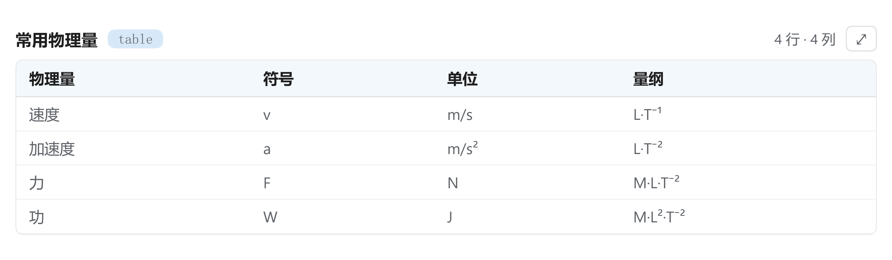

### 2. `show_card` → `flowchart`

1..40 节点、≤80 连线，`shape` ∈ `terminal` / `process` / `decision`。分层布局、分支标签、回边绕右侧 gutter、共享端点自动扇开。点卡片右上角可放大显示。

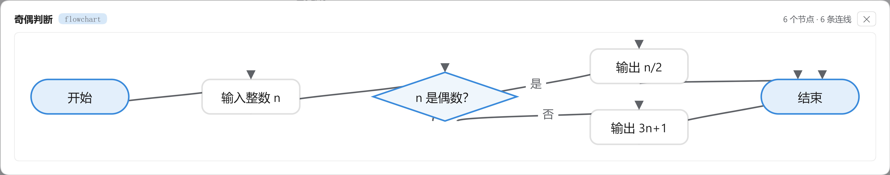

### 3. `show_card` → `draw`

手绘卡：模型只写中心线、形状、文字、胶带或像素网格；钢笔出锋、书法笔角度、荧光笔半透明、铅笔颗粒、手绘抖动全部由引擎算。支持 `draft: true` 私有草稿与最终稿，用户只看到成品。


#### 0.3 起：光与墨也是字段

| 字段 | 用在 | 解决什么 |
|---|---|---|
| `background` | 载荷级 | 画布底色（夜色、牛皮纸），不必拿一个整幅矩形元素伪造 |
| `strokeOpacity` | `path` / `shape` | 同一支笔的浓淡：远处更淡、压住的辅助线；不用换浅色，也不改笔型 |
| `dash` | `path` | 自由曲线画虚线（被挡的棱、轨迹）；此前只有 `shape` 有 |
| `fill` 渐变 | `path` / `shape` | `linear` / `radial` + 2..8 个色标（CSS 角度、`from`/`to` 简写）；一条字段替代 8–12 条色带 |
| `blend` | `path` / `shape` / `pixels` | `normal` / `multiply` / `screen` / `overlay` / `soft-light`：光叠在物体上 |
| `blur` | `path` / `shape` | 光柱、光晕、雾、景深；`blur` 是可见扩散半径，两端都按 σ = blur/2 计算 |

渐变和模糊都按**元素自身的包围盒**解析几何，模型不给坐标，所以「同一份载荷必然同一张图」对它们同样成立；光栅预览逐像素采样，模型看到的预览和卡片一致。

<p>
  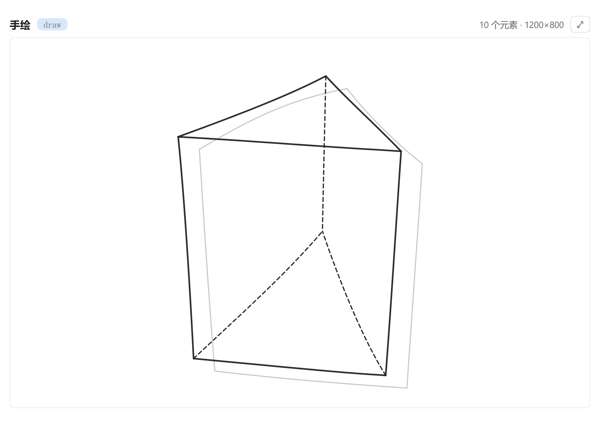
  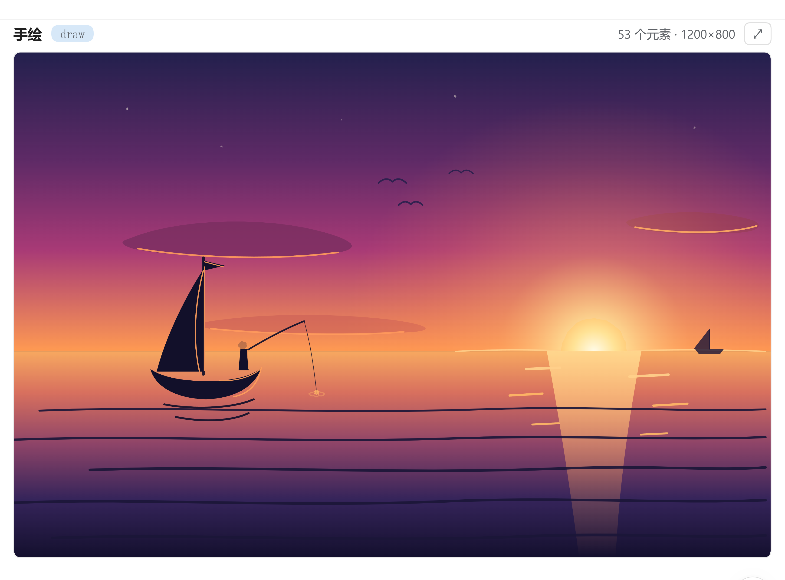
</p>
<p>
  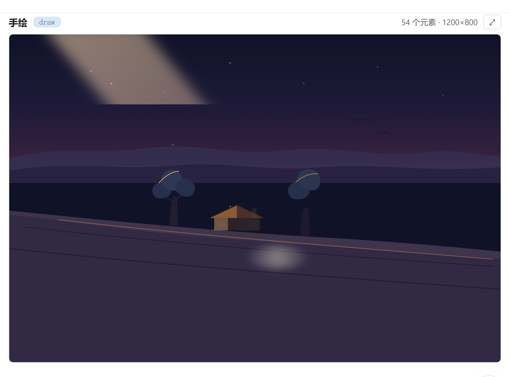
  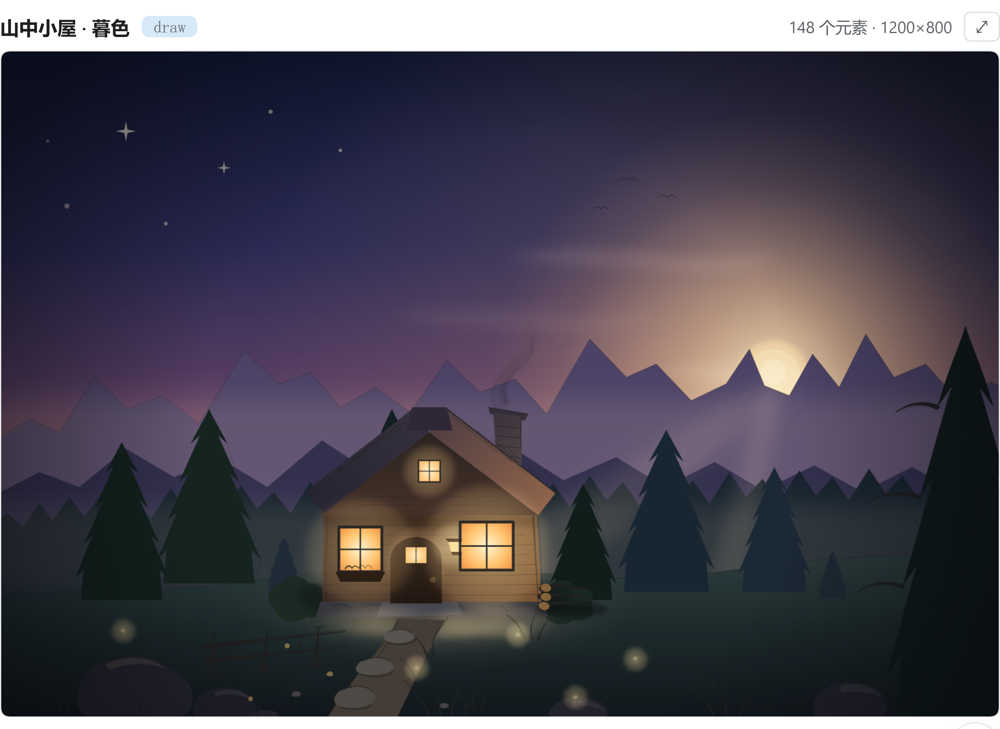
</p>

**渲染是一次性的**：卡片先离屏栅格化成位图再上屏，滚动与放大不再重栅格化。同一张 340 条 `path` 的卡实测：首次滚动从中位 41ms / 单帧 407ms 回到 17ms，放大从 539ms 卡顿降到约 97ms。

### 4. `show_card` → `figure`

教学示意图不塞进 `draw`：前者怕错，后者怕平庸。`figure` 只接受模板与语义参数，坐标、角度、锚点、标签位置全部由渲染器构造。

| 模板 | 模型填什么 | 渲染器保证什么 |
|---|---|---|
| `incline_force` | 角度、质量、摩擦系数、可选 g/分量/数值 | 物块置于斜面；G 竖直、N 垂直斜面、f 沿斜面向上；力的大小由 m/g/θ/μ 计算 |
| `connected_bodies` | 桌面质量、悬挂质量、摩擦系数、可选 g/数值 | 桌面块经定滑轮连悬挂块；T/N/G/f 锚在对应块面上；T 不伪造数值 |
| `orbital_diagram` | 元素符号（H–Zn） | 由参考表推导电子排布与各亚层电子数；按洪特规则画轨道框、↑↓ 与电子排布式 |
| `atom_shell` | 元素符号（H–Ca） | Z 和电子层数从内置参考表推导；电子均匀落位、核标 +Z、K/L/M… 图例 |

<p>
  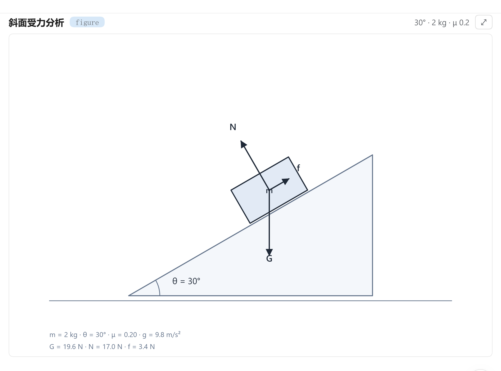
  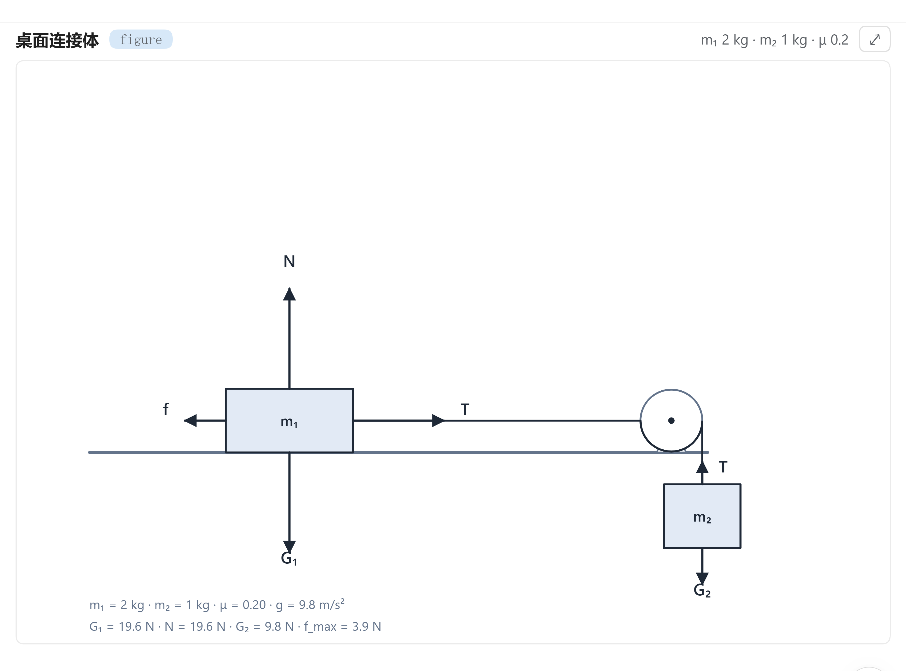
</p>
<p>
  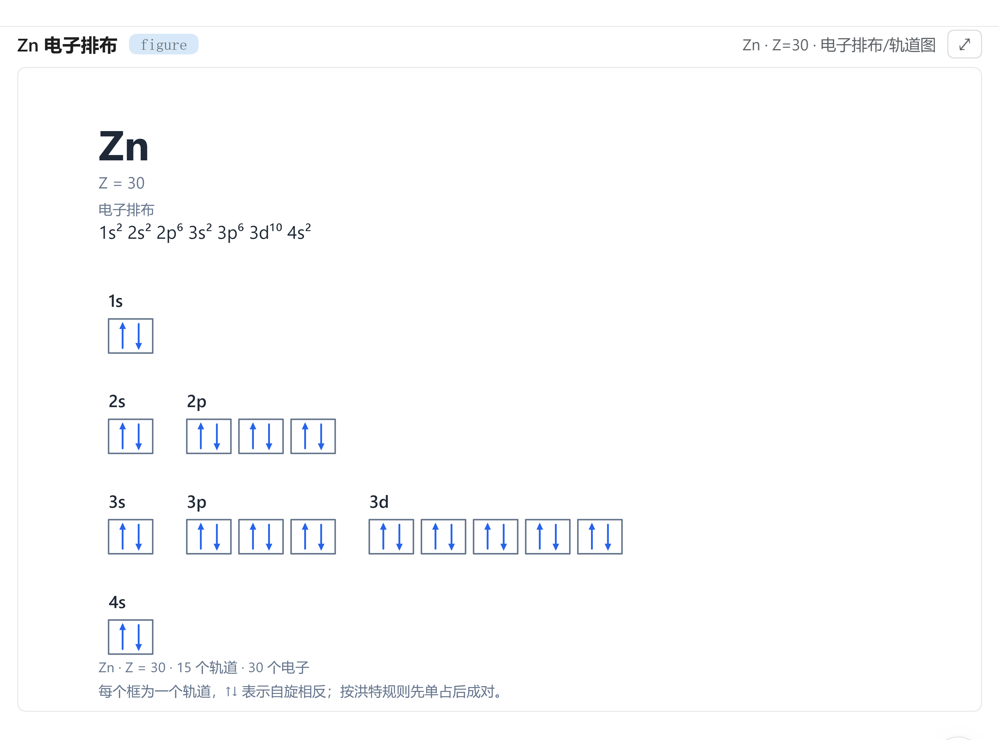
  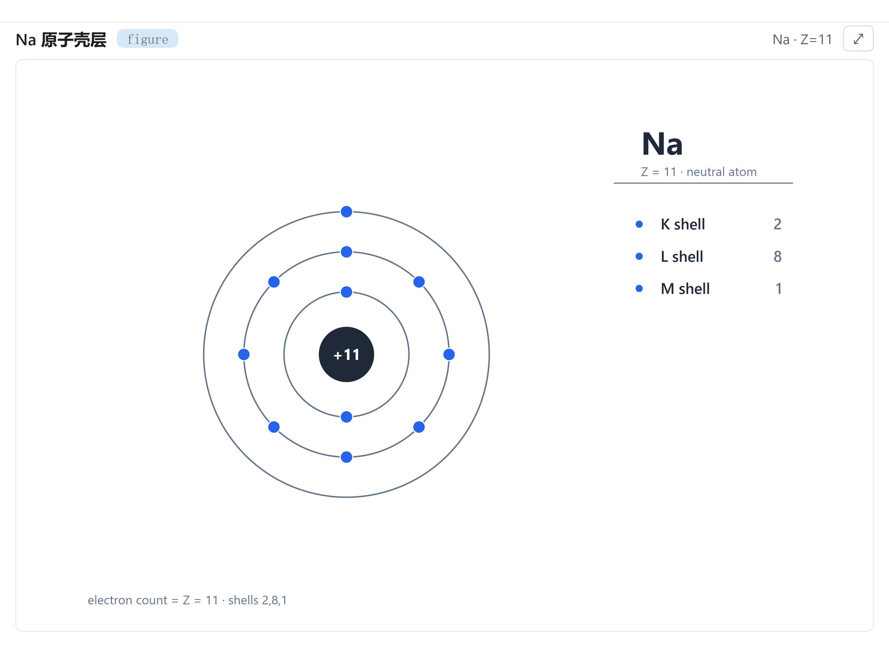
</p>

### 5. `sketch_function` → 六种模式

| 模式 | 画什么 |
|---|---|
| `plain` | 单曲线，y 轴按表达式自适应 |
| `compare` | 多曲线对比（共享窗口，各自独立采样） |
| `tangent` | 指定点的切线（数值微分） |
| `riemann` | n 个矩形逼近定积分 |
| `taylor` | 泰勒展开到 n 阶（展开点可选） |
| `data` | 折线 / 柱状 / 散点 / 饼图 |

<p>
  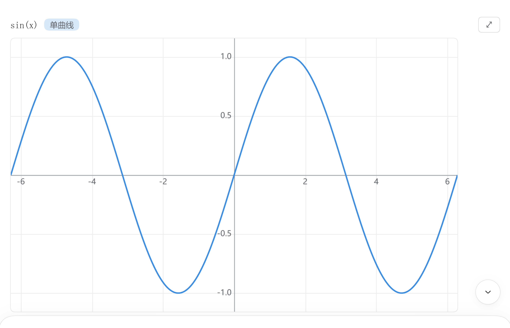
  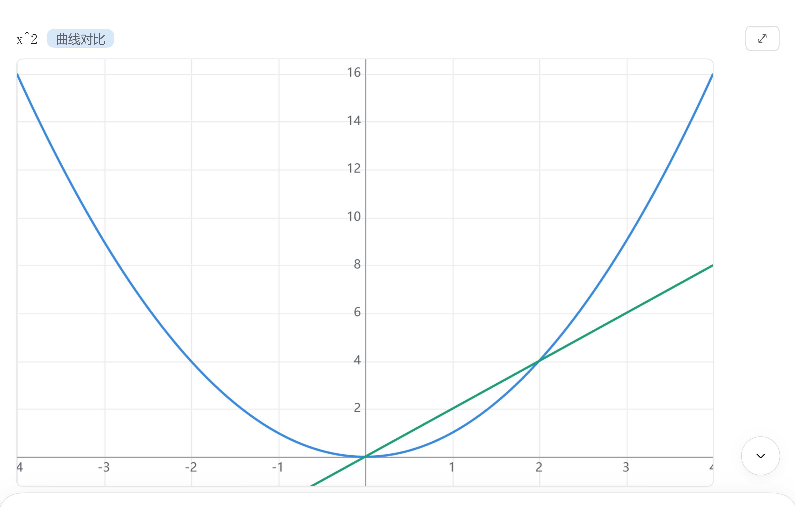
</p>
<p>
  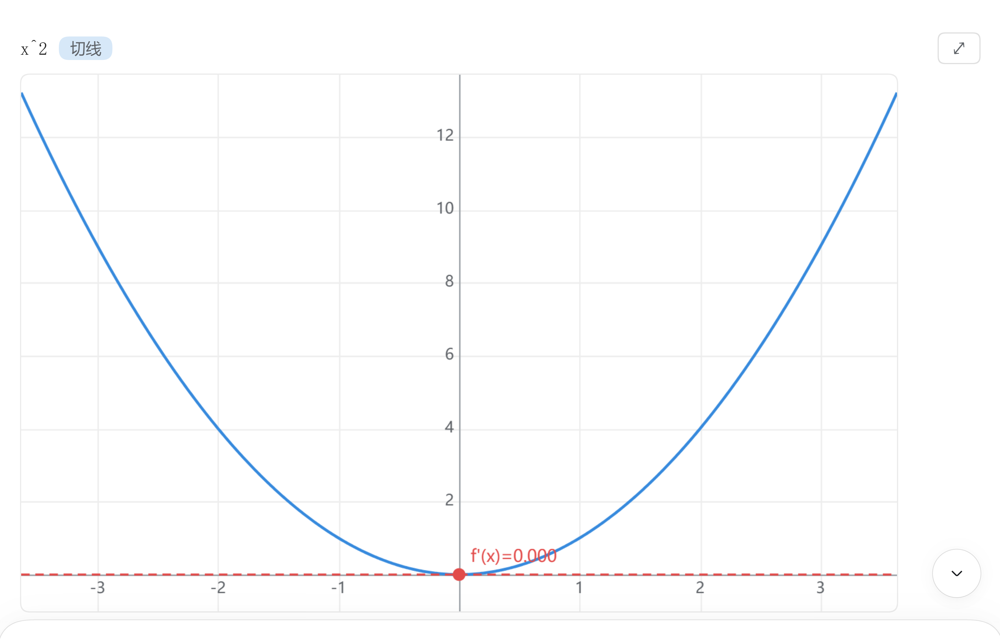
  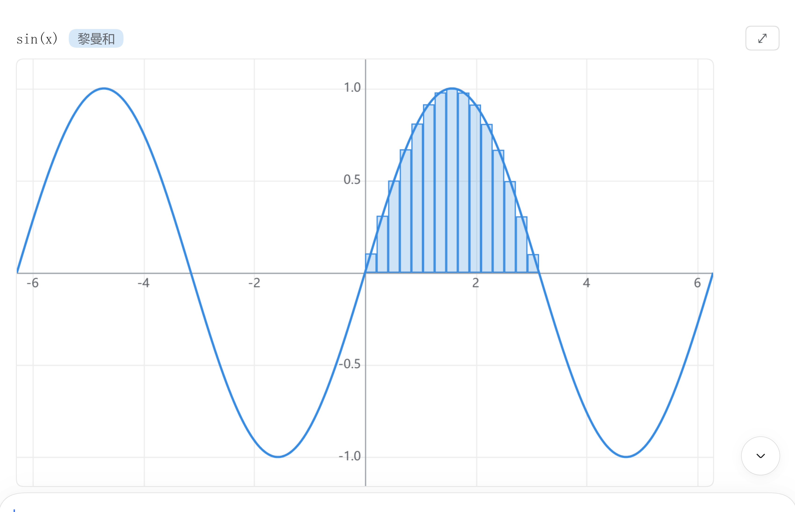
</p>
<p>
  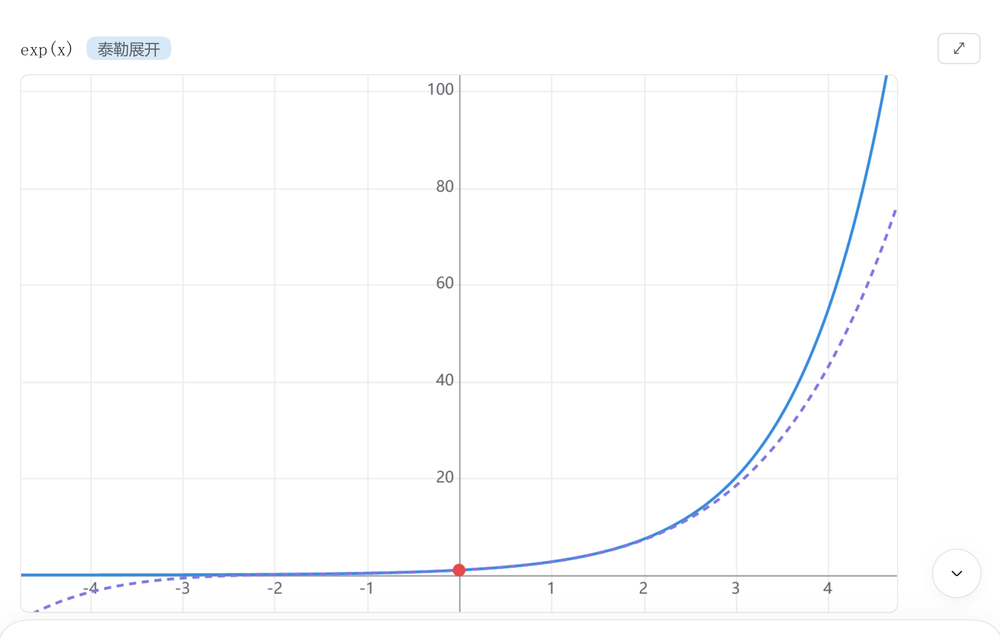
  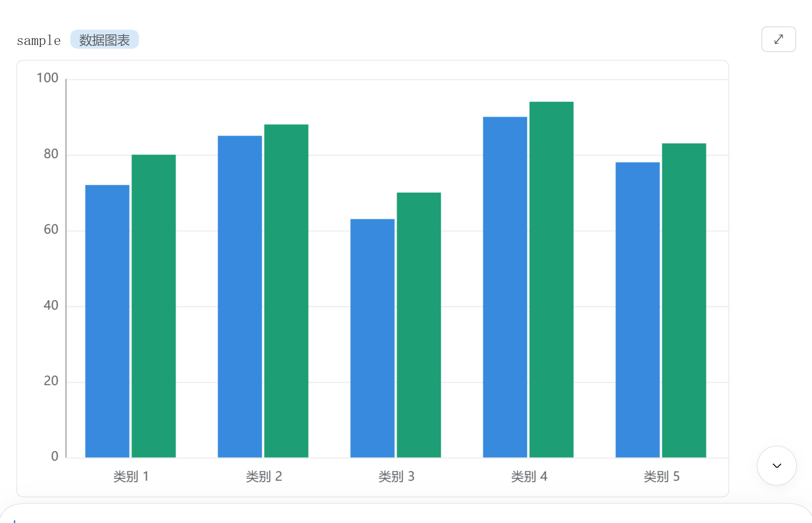
</p>

带 `params` 时出参数滑块；拖拽期间 y 窗口冻结，另有追踪读数（悬停、点按钉住、键盘步进）。交互态全部在组件本地，不写回 spec、不发 Host 调用。

---

## 三、三条设计边界

1. **不执行模型生成的代码。** 没有 `eval`、没有 `new Function`、不把生成的 HTML/SVG 字符串塞进 DOM。`draw` 的路径串只经过自己的迷你语法解析器；未知命令、空路径、指数记法一律拒绝，错误带 `element N:` 前缀，模型可以自己改。
2. **几何是载荷的纯函数。** 流程图分层、换行、箭头锚点、扇开偏移，函数图采样、视窗、数值微分/积分，全部由确定性引擎算。同一 spec 必然同一张图，因此回放等价，也能在 vitest 里断言，不需要 DOM。
3. **校验在 Host 就做。** 列数/行数、节点数/连线数、id 唯一、`shape` 取值、每条连线必须指向已声明节点；不做「画出来少一条边」这种事。报错让模型自己改。

---

## 四、安装

### 方式一：link 安装（推荐，当前已验证）

```bash
git clone https://github.com/QinLuza/dsh-aisketch.git
cd dsh-aisketch

# 构建两个浏览器半边（客户端模块系统读 lib/client.js 原样下发）
pnpm install
pnpm build:client

# 装进 profile（官方命令，实为 pnpm 包装器）
dsh plugin --profile <profile> add link:<repo>/packages/sketch-bundle
dsh --profile <profile> --dump-config    # 应见 4 行 insert
```

桌面端（Electron）的 `desktop` profile 被应用独占，CLI 装不进去；请用应用自己的**插件面板**，安装来源填 `packages/sketch-bundle` 的绝对路径。

### 方式二：从 Git 仓库安装

在插件面板里填本仓库地址，或使用插件市场支持的 Git 安装语法；包目录是 `packages/sketch-bundle`。本仓库没有发布 npm 包，`@aisketch/*` 只是公开作用域名，不依赖 npm 在线安装。

### 兼容性

`packages/sketch-bundle/package.json` 已声明：

```json
{ "engines": { "dsh": ">=0.1.7-rc.2 <0.2.0" } }
```

当前在 `0.1.7-rc.2` 的桌面端与插件系统上实测。dsh 升级到 0.2 之前，先看这个范围是否仍然匹配；不匹配时安装器会直接拒绝，而不是装作能跑。

**改完 Host 半（`cards-core` / `cards-tool` / `sketch-core` / `sketch-tool`）必须重启应用；改完 client 半必须重新构建 `lib/client.js` 并重启。** 运行中重建 client 产物会让整批插件加载失败。

---

## 五、架构

七个包，全部 `@aisketch/*`，**base 仓一行未改**：

| 包 | 职责 |
|---|---|
| `packages/cards-core` | 卡片契约内核：版本化 `CardSpec`、限额校验、`table`/`flowchart`/`draw`/`figure` 载荷解析、`draw` 几何引擎与自检。零依赖 |
| `packages/cards-tool` | Host 工具 `show_card`：schema、拒绝原因、摘要、`draw` 离屏预览与回读 |
| `packages/client-ui-cards` | 浏览器半边：`card` 聊天节点 + `turnTail` 产出物面；`CardView` 按 `spec.kind` 经 registry 派发 |
| `packages/sketch-core` | 纯函数内核：自写 Pratt 表达式解析器、参数摘要、几何采样。零依赖 |
| `packages/sketch-tool` | Host 工具 `sketch_function`：schema、校验、摘要、`presentationMeta` |
| `packages/client-ui-sketch` | 浏览器半边：`tool.call.toolview` 过程行 + `turnTail` 产出物卡，同一 `SketchFigure` |
| `packages/sketch-bundle` | 装配包：`dsh.bundle.patch` → `cordis.patch.yml`（4 行 insert） |

### 两张脸

| 面 | 槽位 | 何时可见 |
|---|---|---|
| 过程行 | `tool.call.toolview`（key = 工具名） | 回合进行中、折叠区打开时实时出图 |
| 产出物 | `conversation.chat.turnTail` | 回合结束后常驻；数据源是持久化事件，回放等价 |

只挂 `toolview` 的卡片会在回合结束后被「回合过程折叠」藏掉；`turnTail` 是 base 留给产出物的槽位。两条通道都同时挂两张脸。

---

## 六、质量与验收

- **539 例**单元/集成测试（cards-core 194 / client-ui-cards 170 / sketch-core 58 / cards-tool 52 / client-ui-sketch 37 / sketch-tool 28），六个包 `tsc --noEmit` 全清。
- 真机验收不是「没报错」：函数图 canvas 像素回读（曲线/坐标轴非零）；流程图截图读到胶囊起点、菱形判断、是/否分支与汇合箭头；电子排布图逐项核对轨道数、电子数与洪特规则；渐变/模糊读渲染后的 DOM（`linearGradient` 停点、`stroke-dasharray`、`filter`）而不是只看截图。
- 回归钉：wiring 闸门（少注册一张脸即红）、`turnTail` 发布键必须等于 Definition 的 kind、draw 的 draft/final 过滤、虚线只能落在描边型笔上、渐变角度按 CSS 约定。

```bash
pnpm test          # 539 passed
pnpm typecheck     # 六个包全清
pnpm build:client  # 两个 lib/client.js
```

---

## 七、已知限制（照实说）

- **有些卡片会被 DSH 的展示逻辑「吞掉」。** 工具调用按定义属于「回合过程」，而 dsh 的工作步骤展示有「简洁 / 标准 / 详细 / 完全展开」四档；在部分档位/版本下，过程区的卡片会被折叠或藏起来，**只有把信息展示切到「完全展开（verbose）」或展开对应回合才能看到**。这是 dsh 对回合过程的显示策略，**不是卡片没渲染，也不是插件坏了**。本插件已经把产出物同时挂到 `turnTail`，但宿主版本与展示设置仍会影响最终可见性；排查时先切「完全展开」，再看卡片是否在。**`table`、`flowchart`、`sketch_function`、`draw`、`figure` 都走同一条通道，表格同样适用**——表格在默认档位被折叠时，切到「完全展开」即可显示。
- **「完全展开」档下会看到同一张卡两次**（过程行 + 产出物行），这是两张脸的副作用，目前未去重。
- **「轨迹」页看不到卡片**：卡片的 view target 是 `chat`，轨迹页按设计只显示原始调用。
- `figure` 目前只有四个模板，不是通用约束求解器；标签位置固定，不做自动避让。
- `orbital_diagram` 支持 H–Zn，`atom_shell` 支持 H–Ca；超出范围会直接报错，不会猜。
- `draw` 是确定性矢量手绘，不是像素级绘画模型；`draft` 草稿默认不展示，模型最多提交一次 final。
- **`draw` 卡片是一张位图快照**：图里的文字不可选中；每张 1200×800 的卡约占 8.6MB 显存（缓存上限 6 张）；首次上屏有约 100–300ms 的占位。换来的是滚动与放大不再重栅格化。
- 模糊、混合模式、渐变都受绘制部件数量影响：三四百条 `path` 的卡仍会比几十条的慢一档，提示词里建议把大色块合并、少用重复罩染。
- Host 半与 client 半的改动都需要重启应用才生效（无 HMR）。运行中不要重建 client 产物。

---

## 八、参与贡献

- 注册你自己的卡片 `kind`：一个载荷解析器 + 一个渲染器 + 一组测试；
- 用出问题请带 `show_card` 的原始参数开 issue；
- 如果它帮你省掉了一坨 ASCII 图，欢迎 star。

---

## License

MIT © 2026 QinLuza. 见 [LICENSE](LICENSE)。
